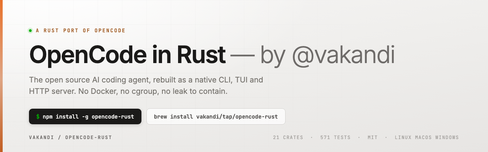

<h1 align="center">opencode-rust</h1>

<p align="center">
  <b>The open source AI coding agent, in Rust.</b>
</p>

<p align="center">
  
</p>

<p align="center">
  
  
  
  
  
</p>

<p align="center">
  A Rust implementation of <a href="https://opencode.ai">OpenCode</a> — CLI, TUI and HTTP server for
  local AI agents. Sessions, tool execution, MCP, LSP and a TypeScript plugin bridge, with no
  container runtime.
</p>

---

## Installation

Three supported surfaces. They install the same engine under the same `opr` command, but they are
**not** interchangeable — `opr` is a dispatcher in some and the engine binary itself in others.

### npm — Linux, macOS, Windows

```bash
npm install -g opencode-rust
```

The launcher is a Node script, which is what makes Windows work at all — `install.sh` writes a
bash `case` statement that Windows cannot execute.

Install never compiles. Prebuilt binaries arrive as separate packages, one per platform, and npm
pulls only the one your machine needs:

- `opencode-rust-darwin-arm64` · `opencode-rust-darwin-x64`
- `opencode-rust-linux-x64-gnu` · `opencode-rust-linux-arm64-gnu` · `opencode-rust-linux-x64-musl`
- `opencode-rust-win32-x64-msvc`

If no binary matches your platform the installer prints the alternatives and exits cleanly, rather
than failing your install or forcing a Rust toolchain on you. Building from source is always an
explicit choice.

### Homebrew — macOS and Linux

```bash
brew install vakandi/tap/opencode-rust
```

Installs `opr` and nothing else. This formula never writes a binary named `opencode` into your
Homebrew prefix, so it cannot shadow the upstream opencode CLI if you have it installed. The
formula builds from source, so the first install pulls a Rust toolchain as a build dependency —
which is exactly the work npm refuses to do during `npm install`.

### From source

```bash
git clone https://github.com/vakandi/opencode-rust.git
cd opencode-rust
./install.sh          # builds the release binary and installs `opr`
```

`install.sh` fingerprints every `.rs` file plus `Cargo.toml`/`Cargo.lock`. Re-running it when the
code is unchanged skips the rebuild entirely; `--force` rebuilds regardless.

```bash
opr                                   # interactive TUI
opr run "check this repo for risks"    # one prompt, runs to completion
opr serve --port 3000                 # HTTP server
```

> **`opr` behaves slightly differently per install.** Through npm it is a dispatching script, so
> `opr --some-flag` becomes `opencode tui --some-flag`. Through Homebrew and `install.sh` it is the
> engine binary itself (Homebrew installs it under the name `opr`), so the same command becomes
> `--some-flag` and is rejected — name the subcommand instead (`opr tui --some-flag`).

### Named-agent shortcuts

`install.sh` also installs one shortcut per agent, each running a single prompt as that agent:

```bash
gilfoyle  "fix this failing test"     # --agent gilfoyle
setbon    "write 5 ad hooks"          # --agent setbon
googlebot "audit my meta tags"        # --agent googlebot
```

No prompt given → usage on stderr and exit 2.

### Requirements

Node 18+. The engine spawns Node subprocesses for its plugin bridge and launches MCP servers
through `npx`, so Node is required regardless of how it was installed.

A provider key is needed before the first run:

```bash
export ANTHROPIC_API_KEY=sk-ant-...
```

---

## Why Rust

OpenCode's engine was TypeScript. It held conversation history in RAM, re-derived the full tool
schema set on every LLM step, and kept per-directory instance state (MCP servers, LSP servers,
plugins) unbounded and never evicted. A Docker runtime existed to *contain* that.

It wasn't enough. Five teams of five agents pinned the CPU at 99% on a MacBook Pro M5 and the
machine became unusable. That was the limit, not the workload.

Rust replaces it. Conversation history spills to SQLite, request bodies stream, tool schemas are
cached per `(model, tool-set)`, and instance state is pooled by config hash with LRU+TTL eviction.
No container, no cgroup, no leak to contain.

---

## The TUI

The terminal UI is where most of the engineering went, and where the bugs were subtlest.

### Messages stay inside their bubble

`render_messages` builds a single `Paragraph` across the whole messages area, so it depends on an
invariant nothing enforces: every line must already be at most `content_width` wide. Most branches
route through `paint_block_lines`, which wraps *and* pads to establish it. Two did not — system
notices, and tool calls, where `render_tool_call` had no width parameter at all and budgeted with a
hardcoded `96`. A failed tool call rendered 107 columns into a 60-column bubble. Both now respect
the width they are given, and an assistant message carrying an API error renders that error instead
of parsing and discarding it.

### The `/` popup is anchored and scrolls

It was handed `frame.size()`, so `area.y` was always `0` and its `saturating_sub` pinned the popup
to row 1 of the screen, far from the input. It also called `render_widget`, which builds a
throwaway `ListState` — so the list never scrolled while the highlight advanced, and a query
matching nothing hid the popup while still capturing every keystroke. It is now anchored to the
prompt rect, scrollable, shows the literal token you must type, and says "No matching commands"
instead of vanishing.

### Streaming actually streams

The SSE listener existed and did nothing useful. Deltas arriving before their message was in the
local transcript were silently dropped; submitting a prompt never armed the fast sync lane; and
every surviving delta triggered a full transcript refetch that overwrote it — roughly fifteen full
fetches per second instead of streaming. Deltas are now buffered and replayed, the fast lane is
armed on submit, and an applied delta triggers a redraw rather than a refetch.

### Agent models are the ones you configured

`/agent` dropped `model` and `model_preference` from the response, so the TUI fell back to a global
default and displayed a model no agent had asked for. On top of that, oh-my-opencode keeps its
agents in `~/.omo/omo.jsonc` rather than `opencode.json`, and plugins register agents under display
names like `Atlas - Plan Executor` while config files key them by slug (`atlas`) — so an exact-key
lookup missed and the configured model never landed on the agent.

Agents are now matched by canonical slug, user config outranks a plugin `config` hook, and the
default agent is `gilfoyle`.

---

## `run` does not abandon its work

The single most important behaviour in this engine.

`run` used to call `AgentExecutor::execute_streaming` — one provider call that **never executed a
tool**. A turn that spawned a subagent, a team, or a background task printed
`[Calling tool: …]` and the process exited, taking that work with it. The TUI masked this because
the TUI never exits.

`run` now drives `SessionPrompt`, the same loop the HTTP server uses, so tools actually run and
awaited subagents complete. After the turn it holds the process open until the work it started is
genuinely finished:

| Stage | What it waits for |
|---|---|
| 1. The turn | `prompt_with_update_hook` returns — tools run, awaited subagents land, pending subtasks drain |
| 2. `session.idle` | Fires the notification omo needs to release its background manager (the CLI never fired this before — a second, independent cause of the cut-off) |
| 3. Children | omo records each spawned subagent/team member as a real row in its own SQLite database; `run` streams their frames and waits for them to go quiet |
| 4. Ledger | `.omo/run-continuation/<session>.json` background-task state, with a staleness guard |

The drain fails **open**, never hangs: no database means no children, a missing ledger file means
idle, corrupt JSON means idle, and a stale `active` entry is treated as finished after the
staleness window. `--wait-background-timeout <SECONDS>` caps the wait (default 120 s).

---

## MCP actually works

MCP was declared in config and silently dead. Three separate defects, each verified in isolation:

| Defect | Symptom | Cause |
|---|---|---|
| stdio framing | Every MCP server timed out at boot | The transport wrote `Content-Length: N\r\n\r\n{…}` — **LSP framing**. MCP stdio is newline-delimited JSON, so every server ignored our bytes |
| config deserialisation | Zero tools after a "successful" boot | `McpServerConfig` was an untagged enum whose toggle variant `{enabled}` matched a full local server first (it also carries `enabled`), so every definition was discarded. Replaced with an explicit `Deserialize` |
| sequential boot | Slowest server held up the rest | Servers started one after another with no bound; now started in parallel under a 90 s ceiling |

After the fix: **3 servers start in ~4 s and 77 tools are exposed to agents.** Tools reach the
model *and* execute — the proxy registers into the same per-turn `ToolRegistry` that resolves the
call.

### Plugin bridge

Plugins are Node subprocesses (`kill_on_drop`). `team_create` is a blocking JSON-RPC into that
subprocess. The reverse channel already exists — `sendNotification` on the TS side, correlated by
`params.requestId` on the Rust side — and is what lets a host observe in-flight progress.

---

## Proxies

The engine ships a rotating residential proxy: a local HTTP/CONNECT forwarder on loopback that
re-selects the oldest-used upstream every 120 seconds, so long agent runs do not burn through a
single egress IP. Candidates are probe-gated — one must open a real CONNECT before it can become
the process egress — and a rejected one is quarantined rather than retried forever.

### Where the pool file goes

```bash
<data-dir>/opencode/proxy-pool.txt
```

Concretely:

- **macOS** — `~/Library/Application Support/opencode/proxy-pool.txt`
- **Linux** — `~/.local/share/opencode/proxy-pool.txt`
- **Windows** — `%LOCALAPPDATA%\opencode\proxy-pool.txt`

If `OPENCODE_PATHS_ROOT` is set, it wins over all of the above and the file is
`$OPENCODE_PATHS_ROOT/opencode/proxy-pool.txt` — the same lever that moves the database and
credentials. Resolve the exact path at runtime with:

```bash
opr debug paths
```

### Format

One proxy per line. Blank lines are skipped, and a malformed line is logged at debug level and
ignored rather than failing the whole pool.

```text
198.51.100.10:8080
203.0.113.24:1080

# (host:port:user:pass)
198.51.100.31:3128:myuser:mypass

# (host:port plus metadata cells)
203.0.113.77:8000 | note:rotates hourly
```

The first two colon-separated fields are required — `host` and a `port` that parses above zero.
Optional `user` and `pass` follow, and `pass` may itself contain colons. Anything after a
` |` separator is metadata parsed **by key** (`last:`, `dur:`), not by position, so a line
carrying `|dur:` without `|last:` keeps its duration.

There is no comment syntax — a line beginning with `#` is simply a line that fails to parse, so
it is dropped with a debug-level log line per occurrence. Keep the file to bare entries.

### Using it

Proxy setup must happen through `opencode_proxy::start()` rather than by exporting the variables
yourself: `reqwest` snapshots the proxy environment when its client is constructed, so the export
has to land before the provider registry is built. With an empty or unreadable pool, `start()`
returns an error instead of binding a listener that would answer `502` for everything — you get a
clear reason rather than a generic connection error.

Sibling files live next to the pool and are managed automatically:

- `proxy-quarantine.json` — candidates that failed their probe
- `proxy-claims.json` — which session currently owns which upstream

---

## Agents

Built-in agents are switched with `Tab`:

- **build** — default, full-access agent for development work
- **plan** — read-only agent for analysis and code exploration

Additional agents are defined in your config. `~/.omo/omo.jsonc` (the oh-my-opencode agent store)
is read alongside `opencode.json`, and a model configured there wins over a plugin default. The
active agent's model is what the TUI displays and what the next prompt sends.

---

## Feature overview

- **Interaction modes** — TUI (default), `run`, HTTP server, Web, ACP
- **Sessions** — create, continue, fork, import/export, parent/child links
- **Tool system** — 22 built-in tools plus live MCP tools in one registry
- **Permissions** — per-path scoping; last matching rule wins
- **Providers** — multi-provider with routing, reasoning-effort control, streaming tool calls
- **Extensibility** — TypeScript plugin bridge, MCP stdio + HTTP, LSP
- **Storage** — SQLite (plural schema: `sessions`, `messages`, `parts`)

---

## CLI commands

```
tui      attach   run      serve    web      acp      models
session  stats     db       config   auth     agent    debug
mcp      export    import   github   pr       upgrade  uninstall
generate version
```

`run` flags:

```
--command  --continue  --session  --fork  --share  --agent  --format
--title    --attach    --dir      --port  --variant  --thinking
--wait-background-timeout <SECONDS>
```

---

## Configuration

Merged from these paths, searched upward:

- `opencode.jsonc` · `opencode.json` · `.opencode/opencode.jsonc` · `.opencode/opencode.json`

Global default: `~/.config/opencode/opencode.json[c]`.

Agent definitions are also read from `~/.omo/omo.jsonc` and `~/.config/omo/omo.jsonc` — the file
oh-my-opencode actually keeps them in. Resolve the data location at runtime with:

```bash
opr db path
```

---

## Repository structure

```
crates/
  opencode-cli        CLI entrypoint (binary: opencode) + agent aliases
  opencode-server     HTTP/SSE/WebSocket server, MCP loader
  opencode-session    Session prompt loop, subtasks, status
  opencode-agent      Agent executor (looping + streaming variants)
  opencode-tool       22 built-in tools + registry + permission context
  opencode-provider   Provider adapters (OpenAI, Anthropic, …)
  opencode-mcp        MCP client + stdio/HTTP transports
  opencode-plugin     Plugin host bridge (subprocess)
  opencode-lsp        LSP clients
  opencode-storage    SQLite storage
  opencode-tui        Terminal UI
  opencode-permission opencode-config  opencode-core  opencode-types
opencode-paths      opencode-command opencode-grep opencode-proxy
  opencode-util       opencode-watcher
npm/                   npm packages: launcher, platform binaries, opr alias, homebrew formula
docs/                  per-crate documentation
```

Per-crate documentation lives in [`docs/`](./docs).

---

## Operations

| Script | Purpose |
|---|---|
| `install.sh` | Build + install `opr` and agent aliases. `--force` rebuilds |
| `clean.sh` | Refuses to clean while this repo's binary is running, warns before touching an `opencode` that is not ours, clears `target/` |

### Publishing

Releases go out through GitHub Actions on a `v*` tag, using npm **trusted publishing** — the
workflow exchanges a short-lived OIDC JWT for a publish credential. There is no long-lived token
in the repo and no 2FA code to type.

Trusted publishing must be configured once per package on npmjs.com under
**Settings → Trusted Publisher**, pointing at `vakandi/opencode-rust` and
`.github/workflows/publish.yml`. Without that the workflow cannot authenticate.

To publish by hand instead:

```bash
cd npm/platform/opencode-rust-darwin-arm64 && npm publish --access public
cd npm                                   && npm publish --access public
```

Order matters: the binary package must be on the registry before the launcher, because the
launcher declares it as an optional dependency.

---

## Development

```bash
cargo test --workspace          # 571 tests
cargo build --release --bin opencode
cargo clippy --workspace --all-targets
```

---

## Known limitation

`run` is verified against a real `bash` tool through the real session engine. It has **not** been
exercised end-to-end against a funded provider: free OpenRouter models reject the tool schema and
paid ones return 402 without credits. The loop is provider-agnostic, but we publish what we
measured rather than a result we did not get.

---

## License

MIT — see [LICENSE](./LICENSE).

A Rust implementation of [OpenCode](https://github.com/anomalyco/opencode). Not affiliated with
the OpenCode team.